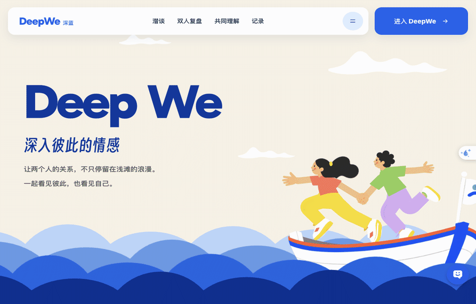
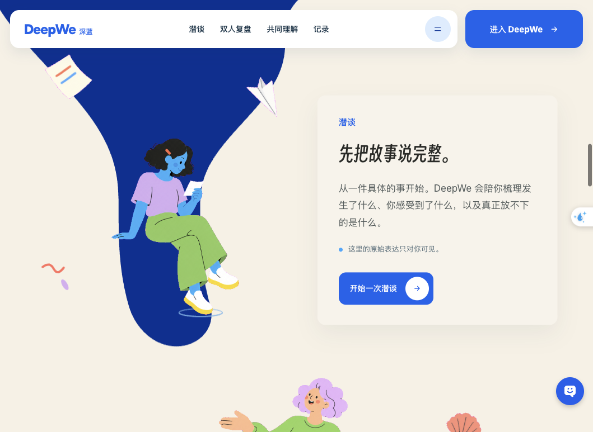
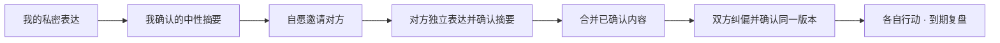

<div align="center">

# DeepWe · 深蓝

### 先听见自己，再慢慢靠近彼此。

为亲密关系而做的 AI 私密支持与双人异步复盘。

[**访问官网 ↗**](https://s2fslv06rel2qvptljhke.apigateway-cn-beijing.volceapi.com/) · [**进入深蓝 ↗**](https://s2fslv06rel2qvptljhke.apigateway-cn-beijing.volceapi.com/app) · [本地运行](#本地运行) · [使用许可](#使用许可) · [English](#english-overview)


<a href="https://s2fslv06rel2qvptljhke.apigateway-cn-beijing.volceapi.com/">
  
</a>

<sub>公开官网的滚动动画实录。展示素材不含登录账号、私聊或用户记录。<a href="docs/assets/deepwe-hero.png">查看静态画面</a></sub>

</div>

---

## 为什么做深蓝

有时，一次争执之后，我们还没有想清楚自己为什么难过，就已经开始解释、反驳，或者急着把对方拉进一场对话。

深蓝想留出一点空间。你可以先独自说，把感受和发生的事慢慢分开。等你愿意，再邀请另一半分别表达，把各自确认过的内容放在一起看。

一个人也可以使用深蓝。对方是否参与，由你们各自决定。

## 第一次来，从这里开始

| 你想了解什么 | 建议从哪里看 |
| :--- | :--- |
| 深蓝是什么，画面和体验怎样 | [打开官网](https://s2fslv06rel2qvptljhke.apigateway-cn-beijing.volceapi.com/) · [四项核心功能](#在深蓝里可以做什么) |
| 我的表达会不会被对方看到 | [分享流程](#私密表达怎样变成共同理解) · [隐私与模型数据路径](docs/PRIVACY.md) |
| 想在自己的电脑上研究和运行 | [本地运行](#本地运行) · [公开版范围与已知问题](docs/PUBLIC_RELEASE.md) |
| 想用于商业项目或提交代码 | [使用许可](#使用许可) · [贡献说明](CONTRIBUTING.md) |

公开官网可以直接浏览。在线应用的使用以站点当前的注册和邀请规则为准。

## 在深蓝里，可以做什么

| 潜谈 | 由本人控制的 Memory |
| :--- | :--- |
| 围绕当下具体的关系困扰展开私密对话，整理感受、事实和想得到的帮助。 | 选择是否开启跨对话记忆，查看记忆及来源，按自己的意愿纠正或遗忘。 |
| **双人异步复盘** | **共同理解与行动** |
| 两个人分别表达，各自确认分享内容；原始私聊留在各自的空间。 | 核对双方视角，纠正不准确的理解，分别确认行动，到期再回看。 |



## 私密表达，怎样变成共同理解



- 原始表达属于本人。共同空间接收本人明确确认分享的摘要。
- 对方完成自己的表达和摘要确认前，看不到你的摘要。
- 修改共同理解后，双方需要重新确认同一版本。
- Memory 的开启、查看和遗忘由本人控制，记忆不等于双方共同认可的事实。
- 服务端检查身份、参与角色和流程状态；浏览器传来的角色标签不授予权限。

模型服务与数据存储的具体边界，见 [隐私与模型数据路径](docs/PRIVACY.md)。

## 本地运行

使用 Node.js **20.20 或更新的 20.x 版本**和 npm。首次安装 `better-sqlite3` 时，部分平台可能需要本机编译工具。

```bash
git clone https://github.com/Irixil/DeepWe.git
cd DeepWe
npm ci
npm --prefix backend ci
cp .env.example .env.local
cp backend/.env.example backend/.env.local
```

分别在两个终端启动后端和前端。

```bash
# 终端一
cd backend
npm run dev
```

```bash
# 终端二，在项目根目录
npm run dev
```

打开 [localhost:3000](http://localhost:3000)。默认不提供模型密钥，未配置时使用演示回应，便于先检查界面与流程。真实 AI 功能需要你自行配置模型服务，相关使用可能产生供应商费用。

前端通过 `BACKEND_URL` 访问后端。默认开发端口为前端 `3000`、后端 `4000`；`3001` 也在开发来源白名单内。部署到自己的域名时，需要核对 `backend/src/security.ts` 的允许来源、HTTPS、持久化存储和所有者配置，不能直接照搬本地环境。

### 工程检查

```bash
npm run lint
npm run typecheck
npm test
npm run build
npm --prefix backend run build
```

当前 Node 20.20.0 下，24 个后端测试文件、735 项离线检查全部通过，包含对首次公开时 6 项失败的修复和两项新增反向检查。详细原因见 [公开版范围与测试说明](docs/PUBLIC_RELEASE.md)。工程检查不代表真实模型质量、长期使用效果或完整产品验收。

## 项目结构

```text
DeepWe/
├── src/                 首页、私密对话、Memory 与双人页面
├── backend/src/         API、身份校验、状态机、AI 与 SQLite
├── config/              公开静态资源清单
├── public/              官网插画、字体与第三方声明
├── docs/                展示素材、隐私说明与公开版说明
└── LICENSE              非商业使用许可证
```

前端使用 Next.js、React 和 TypeScript；后端使用 Hono 与 SQLite。模型由服务端调用，密钥不应放进浏览器代码。

## 当前阶段

这是一个持续开发中的个人产品。当前公开副本整理自已交付版本的代码，包含本地运行配置和可移植的虚构回归夹具；没有附带生产数据库、个人对话、密钥、内部验收记录或旧 Git 历史。

部分工程、权限和虚构双人流程已有检查记录。真实模型在更广泛场景中的自然回应、长期 Memory 效果和专业审阅仍需继续验证。Google 管理验证的在研增量没有混入本次公开副本。详见 [公开版范围](docs/PUBLIC_RELEASE.md)。

深蓝提供情绪支持和沟通整理，不提供临床诊断或治疗。

## English overview

**DeepWe** is an AI companion for private emotional support and relationship reflection. It combines individual conversations, user-controlled cross-conversation memory, and an optional asynchronous reflection flow for couples.

Each person keeps their raw conversations private and chooses what to share. The shared flow works with confirmed summaries, corrections, mutual confirmation, individual actions, and follow-up reflection.

Built with Next.js, React, TypeScript, Hono, and SQLite. This project is under active development and is **source available for noncommercial use**. Commercial use requires a separate license. It is not a clinical diagnosis or therapy service.

## 使用许可

项目自有代码使用 **[PolyForm Noncommercial License 1.0.0](LICENSE)**。允许许可证范围内的学习、研究、个人自用、修改和非商业分发；商业用途需要另行取得作者授权。该标准许可也包含其列明的非商业组织用途，完整范围以许可证原文为准。

**源码公开不等于可以任意商用。** 这是一项非商业许可的源码公开项目，不以 OSI 开源许可证发布。

代码许可不授予冒用 DeepWe／深蓝名称、标识或官方身份的权利。原有版权声明和许可应当保留；第三方组件继续适用各自的许可证，见 [第三方说明](THIRD_PARTY_NOTICES.md)。

商业授权可以通过 [授权咨询 Issue](https://github.com/Irixil/DeepWe/issues/new?title=Commercial%20license%20inquiry) 联系作者。请只提供一般用途，不要在公开 Issue 中提交关系文本、账号资料或商业机密。

## 参与与反馈

欢迎提交可复现的问题和产品建议。代码贡献请先阅读 [贡献说明](CONTRIBUTING.md)；本项目不自动接收未经授权安排确认的外部代码。安全问题请参考 [安全报告方式](SECURITY.md)。

<div align="center">

---

**DeepWe · 深蓝**

深入彼此的情感，也给自己一点空间。

[官网](https://s2fslv06rel2qvptljhke.apigateway-cn-beijing.volceapi.com/) · [体验深蓝](https://s2fslv06rel2qvptljhke.apigateway-cn-beijing.volceapi.com/app) · [反馈](https://github.com/Irixil/DeepWe/issues)

</div>
